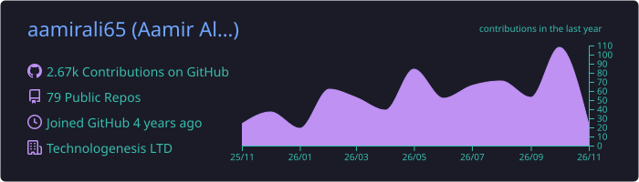
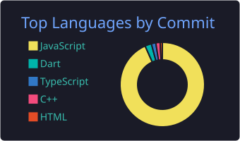

**as far as i can remember i always wanted to be a** <del>gangster</del> **developer**

**Karachi, Pakistan** · Flutter Developer at **Zilo Digital** · CS undergraduate at **SZABIST**

---

## About

I build products end to end — the interface, the state, the API and the deployment. Most of my work is **Flutter** on mobile and **React / Next.js** on the web, with Firebase or Supabase behind it, and I care more about a thing running in someone's hands than about a repo that looks impressive.

Recent focus: **local-first desktop tools** that keep data on the machine — a video clipping studio driven by Ollama and FFmpeg, a privacy-first OCR utility, and a codebase assistant that runs on the desktop instead of a web page.

---

## Stack

**Frontend**

**Backend**

**Databases**

**Mobile & desktop**

**DevOps & tooling**

---

## Featured work

| Project | What it is | Built with | Live |
|---|---|---|---|
| **[clipper-studio](https://github.com/aamirali65/clipper-studio)** | Local-first AI clip studio for Windows: multi-clip timeline, Whisper captions, face-tracking crop, queued exports to vertical shorts | Python · PySide6 · FFmpeg · Ollama · SQLite | Desktop app |
| **[REPO](https://github.com/aamirali65/REPO)** | Desktop app that indexes a repository and answers questions about it with RAG — OAuth, code explorer, impact analysis | TypeScript · Electron · React · Vite | [repo-desktop.vercel.app](https://repo-desktop.vercel.app/) |
| **[pet-clinic-rush](https://github.com/aamirali65/pet-clinic-rush)** | Hyper-casual vet game: treat pets before their patience runs out, keyboard and touch, packaged for Android | TypeScript · Phaser 3 · Vite · Capacitor | [Play it](https://aamirali65.github.io/pet-clinic-rush/) |
| **[coligo-university-management-system](https://github.com/aamirali65/coligo-university-management-system)** | University management system with five role-based portals — admin, faculty, student, finance, registrar | React · TypeScript · Tailwind · shadcn/ui · Zod | [coligo-ums.vercel.app](https://coligo-ums.vercel.app/) |
| **[docscan](https://github.com/aamirali65/docscan)** | Offline document scanner: ML Kit OCR, text extraction and editing, no network at runtime | Flutter · Dart · Google ML Kit | [Releases](https://github.com/aamirali65/docscan/releases/latest) |
| **[playvault-casino](https://github.com/aamirali65/playvault-casino)** | Demo games platform with 15 provably-fair games, tournaments, leaderboards and an admin console | Next.js 16 · React 19 · TypeScript · Zustand | [play-vault-sigma.vercel.app](https://play-vault-sigma.vercel.app/) |

<b>More projects</b>

 

- **[bidder-onlineauctionapp](https://github.com/aamirali65/Bidder-OnlineAuctionApp)** — real-time auction app with role-based buyers and sellers · Flutter · Supabase
- **[unitrack](https://github.com/aamirali65/Unitrack-EduPortalApp)** — student/teacher classroom portal · Flutter
- **[hireme-jobportalapp](https://github.com/aamirali65/HireMe-JobPortalApp)** — job portal connecting seekers and recruiters · Flutter · Supabase
- **[sovely](https://github.com/aamirali65/sovely)** — meditation and focus app with ambient sound and breathing exercises · Flutter
- **[scopy](https://github.com/aamirali65/scopy)** — Windows screen-region OCR to clipboard, fully offline · C#
- **[maply-ai-growth-assistant](https://github.com/aamirali65/maply-ai-growth-assistant)** — AI growth coach for local businesses · Flutter · AI
- **[bundle-visualizer](https://github.com/aamirali65/bundle-visualizer)** — Dart CLI that reports Flutter bundle size, assets and dependencies · Dart
- **[code-converter](https://github.com/aamirali65/code-converter)** — converts code between languages via a Gemini-backed route · Next.js · TypeScript

---

## Social media

---

## Activity

 
 

 
 

<picture>
  <source media="(prefers-color-scheme: dark)" srcset="https://raw.githubusercontent.com/aamirali65/aamirali65/output/github-contribution-grid-snake-dark.svg" />
  <source media="(prefers-color-scheme: light)" srcset="https://raw.githubusercontent.com/aamirali65/aamirali65/output/github-contribution-grid-snake.svg" />
  
</picture>

---

## Experience

**Flutter Developer · Zilo Digital, Karachi** — *Feb 2025 – Present*
Building cross-platform mobile and web applications with Flutter and Firebase; focused on responsive UI and on keeping data flow between client and API clean.

**Angular Developer · Technologenesis, Karachi** — *Aug 2023 – Jan 2025*
Built single-page applications in Angular with REST integrations, and refactored UI into reusable, maintainable components.

**Frontend Developer (Intern) · Technologenesis, Karachi** — *Jun 2023 – Aug 2023*
Turned design mockups into responsive interfaces with React, Tailwind CSS and modern JavaScript.

## Education

- **B.S. Computer Science** — SZABIST, Karachi *(2024 – present)*
- **Diploma in Software Engineering** — APTECH Pakistan *(2021 – 2024)*
- **Higher Secondary Certificate, Pre-Engineering** — Govt. H.S. School Dakhan *(2023 – 2024)*, grade A+

---

**Open to interesting problems — reach me at [contact.aamirali65@gmail.com](mailto:contact.aamirali65@gmail.com)**

